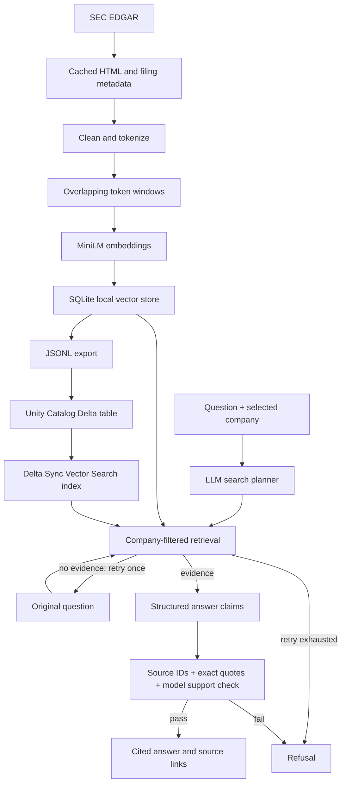

# PolicyPilot — SEC Filing Research with Agentic RAG

A Python application that retrieves evidence from SEC 10-K filings, drafts cited answers,
and refuses answers that fail evidence checks. Built with LangGraph, local semantic search,
and adapters for Azure Databricks, Unity Catalog, Delta Lake, Vector Search and Unity Gateway.

**Status:** implementation with offline tests and a runnable demo. Live SEC ingestion needs
an identifying user-agent; model inference needs a Groq key or configured Databricks model
service. Azure resources have not been deployed or verified in a user workspace. This repo
supports a 20-company universe; it does not claim that all 20 have already been ingested.

## Quick start

Requires Python 3.11–3.13 and [uv](https://docs.astral.sh/uv/).

```bash
uv sync --frozen --group dev
uv run policypilot demo
uv run streamlit run app.py
```

Choose **Offline demo** in the UI for fictional documents and keyword retrieval without keys.
This is distinct from the real semantic RAG path below.

## Real filings and semantic RAG

```bash
uv sync --frozen --extra semantic --group dev
cp .env.example .env
# Edit .env: set a real SEC_USER_AGENT contact and your GROQ_API_KEY.
uv run policypilot ingest --tickers AAPL
uv run policypilot ask "What supply chain risks are disclosed?" --ticker AAPL
uv run streamlit run app.py
```

Choose **SEC filing research** in the UI. The embedding model downloads on first use.
Groq receives the question and retrieved public filing passages. The selected model must
be available to your account. Data stays under the ignored `data/` directory locally.

```bash
uv run policypilot ingest --all
uv run python -m policypilot.evaluation
```

Ingestion reports each company independently and exits unsuccessfully if any company
fails. See `data/ingestion-report.json`. A failed refresh preserves previously indexed
passages. One latest successfully ingested 10-K is retained per company. The selected
company is an explicit UI/CLI filter, not an LLM guess. Multi-company comparisons and
historical year selection are not implemented.

## Architecture



## What's implemented

- SEC ticker resolution, older-submission fallback, request throttling, bounded retries,
  immutable document caching, provenance and per-company ingestion reports.
- Token-aware chunking sized to the embedding model; stable content-derived chunk IDs.
- Atomic company refreshes and cosine search using SQLite/NumPy locally. This exhaustive
  search is suitable for a portfolio corpus, not a distributed enterprise search engine.
- LangGraph planning, bounded retry, structured generation, citation validation, a separate
  LLM support check, refusals and visible execution traces.
- Streamlit question interface with document text, dates, accessions and SEC links.
- Evaluation runner, offline tests, dependency lockfile, CI, manual OIDC deployment workflow.
- Databricks retrieval/gateway adapters, Delta loading notebook, index provisioning script,
  and app deployment bundle. Setup is described in [deployment](docs/deployment.md).

## Validation and limitations

```bash
uv run pytest -q
uv run ruff check src tests app.py notebooks scripts
uv run ruff format --check src tests app.py notebooks scripts
uv build
```

Tests use deterministic doubles for external services. They verify graph routing, refusal,
company isolation, citation rejection, SEC fallback/retries, and atomic storage behavior.
Live evaluation results are written only when you run the evaluation command. Starter
questions are not a human-labeled accuracy benchmark. Add source-specific expected
passages and human-reviewed answers before reporting retrieval recall or answer accuracy.

A valid quote does not prove that a claim is true. The support-check model can also be
wrong, particularly when judging its own generation. Inspect sources. Retrieved content
is treated as untrusted input, but prompt injection is not completely solved. The app is
for filing research, not investment predictions. HTML table extraction is basic and may
lose layout; use structured XBRL for precise financial computations in a future extension.

No app-level user authorization is implemented. Databricks production access must be
configured through app access, service-principal permissions, catalog/index grants and
model-service permissions. The company selector is a retrieval filter, not an ACL.

## Project map

```text
app.py                        Streamlit interface
src/policypilot/
  sec.py                      EDGAR acquisition and HTML cleaning
  embeddings.py               Token-aware chunks and embeddings
  store.py                    Atomic local vector store
  ingestion.py                Per-company ingestion orchestration
  agent.py                    LangGraph workflow and evidence checks
  llm.py                      Groq / Unity Gateway model calls
  databricks_backend.py       Managed vector search adapter
  cli.py                      Demo, ingestion, question and export commands
  evaluation.py               Live evaluation report
  demo.py                     Offline learning example
notebooks/load_delta.py      Export-to-Delta ingestion
scripts/create_vector_index.py
.github/workflows/           Offline CI and manual cloud deployment
```

Read [the concepts lesson](docs/01-understand-the-flow.md), [deployment](docs/deployment.md),
and [GitHub publishing](docs/github.md). The supplied reference archive is excluded from
Git and release packaging. This implementation was written separately; see
[reference review](docs/reference-review.md) for its design context.
