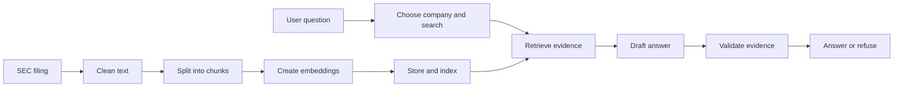

# Lesson 1: follow the evidence

Suppose someone asks: “What supply chain risks does Apple disclose?” A language model
may know general facts about Apple, but your application needs evidence from a specific
filing. RAG means retrieval-augmented generation: retrieve relevant passages, then supply
them to the model as context for its answer. This does not train the model on the filings.

## Two separate flows

The first flow is ingestion: it runs when documents are added or updated. The second
flow runs for each question. Downloading and embedding every filing per question would
be unnecessarily slow and expensive.

## Understand the runnable code

Run `uv run policypilot demo` and open `src/policypilot/demo.py`.

`Chunk` bundles text with a stable ID, company ticker and source description. Text without
provenance cannot produce a useful citation. The training documents are deliberately
fictional so their content cannot be mistaken for real company disclosures.

`search()` selects the company first, counts matching words, and returns the best matches.
This is lexical retrieval. A semantic retriever instead encodes the question and passages
into numeric vectors, then ranks passages by vector similarity. Related meanings can
match even when wording differs. Similarity is not a probability that an answer is true.

`State` is the information passed through the graph. A LangGraph node is a Python
function that reads state and returns updates. An edge determines which function runs
next. Here, `retrieve` has a conditional edge: no evidence goes directly to `refuse`.
See the [LangGraph graph API](https://reference.langchain.com/python/langgraph/graph/state/StateGraph/add_conditional_edges).

`quote()` copies retrieved text. In a later lesson an LLM will synthesize an answer.
`valid_evidence()` checks that each cited ID belongs to the retrieved evidence and that
each quoted passage actually occurs there. This is stronger than checking for brackets,
but a genuine quote can still be irrelevant or misleading outside its context. We do
not label this check “hallucination prevention” or factual correctness.

## Connect this to the Delta Lake illustration

Think of object storage as the building, files as boxes, and a Delta table's transaction
log as the inventory ledger. Readers see a committed table version rather than part of
an unfinished update. Version history is subject to retention; it is not permanent backup.

Unity Catalog supplies the catalog and access rules around data and other governed
objects. Delta Lake supplies the table format and transactions. Vector Search supplies
retrieval over embeddings. Databricks supplies compute and managed services that operate
these pieces. They solve different problems and work together.

A Delta Sync index follows a source Delta table. Triggered sync still needs to be run;
an index should not be assumed current immediately after a table write.
See [Azure Databricks index creation](https://learn.microsoft.com/en-us/azure/databricks/vector-search/create-vector-search).

## Try three experiments

1. Run `uv run policypilot demo "supply chain" --ticker OTHER`. Why does the source change?
2. Run `uv run policypilot demo "Martian population"`. Which nodes are skipped?
3. Compare the unknown-source and invented-quote tests. Why are these different failures?

You understand this lesson when you can explain why retrieval, generation and validation
are separate functions, and why a citation alone cannot establish factual support.
